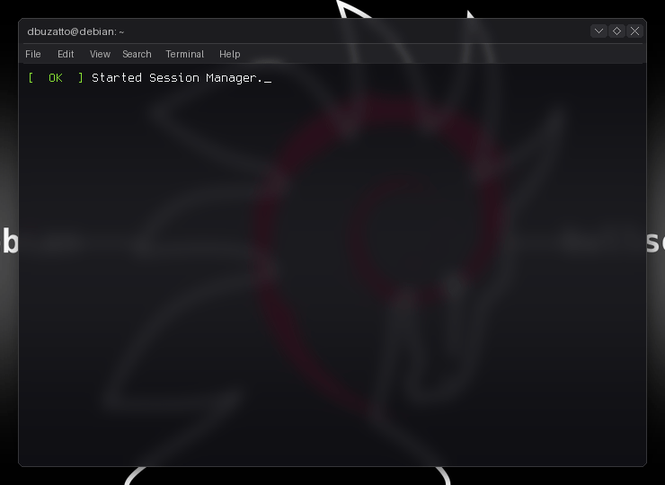

<div align="center">

# ⚡ Terminal GIF Generator for Tomoya Okazaki

**Automated dynamic terminal GIF engine showcasing real-time GitHub statistics and Purple Teaming toolchain — auto-generated daily via GitHub Actions.**



[](https://github.com/Tomoya0086/gif-terminal-/stargazers)
[](https://github.com/Tomoya0086/gif-terminal-/network/members)
[](LICENSE)

<br/>

> *"Nothing can stay unchanged. Fun things… Happy things… They can’t possibly remain the same."*

</div>

---

## 🛡️ Overview

This repository powers the automated dynamic terminal console for **[Tomoya Okazaki (@Tomoya0086)](https://github.com/Tomoya0086)**. It queries the GitHub REST API for live telemetry and renders a frame-by-frame animated terminal GIF using `gifos` and Pillow.

### Key Capabilities
- 📊 **Real-Time Telemetry:** Live commits, stars, pull requests, repository contributions, and primary language percentiles.
- 💻 **Custom Purple Team Stack:** Pre-configured with Tomoya's core toolchain (`Python 3`, `C`, `Kali Linux`, `Burp Suite`, `Docker`, `Wireshark`).
- 🎨 **Multi-Theme Support:** 
  - **Debian / Kali GNOME:** Titlebar, terminal controls, and systemd boot sequence.
  - **macOS Liquid Glass:** Frosted translucent glass terminal.
  - **Classic Dark:** High-contrast cyber terminal.
- ⚡ **Zero-Maintenance CI/CD:** Auto-generates, optimizes, and commits `output.gif` daily at 06:00 UTC via GitHub Actions.

---

## ⚙️ Configuration & Automated Workflow

The automated engine runs via [`.github/workflows/generate-gif.yml`](.github/workflows/generate-gif.yml).

### Repository Secret
To enable live telemetry fetching, add your GitHub Personal Access Token (`read:user` scope):

1. Go to **Settings → Secrets and variables → Actions**.
2. Click **New repository secret**.
3. Name: `GH_TOKEN`
4. Value: `ghp_...`

### Selecting a Theme
You can switch themes by adding a Repository Variable under **Settings → Secrets and variables → Actions → Variables**:

| Variable | Values | Description |
|---|---|---|
| `THEME` | `debian` *(recommended)*, `default`, `macos` | Active visual layout and window chrome |
| `WALLPAPER` | Filename inside `assets/` | Custom background wallpaper for Debian theme |

---

## 🛠️ Running Locally

```bash
# 1. Install dependencies
pip install github-readme-terminal requests python-dotenv Pillow

# 2. Configure credentials
cp .env.example .env
# Set GITHUB_TOKEN and GIT_USERNAME=Tomoya0086

# 3. Generate your preferred theme
python3 generate_debian.py       # Kali / Debian GNOME theme
python3 generate_with_stats.py   # Classic Dark theme
python3 generate_liquid_glass.py # macOS Liquid Glass theme
```

---

<div align="center">
  <sub>Configured exclusively for <a href="https://github.com/Tomoya0086">Tomoya0086</a>. Built for technical precision.</sub>
</div>
